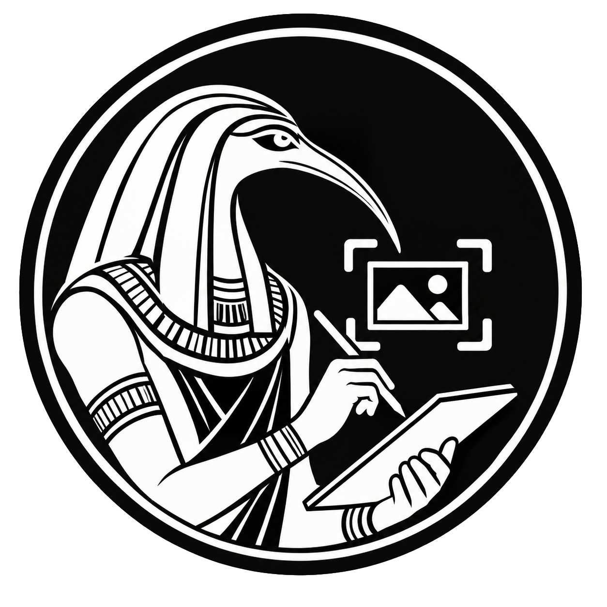
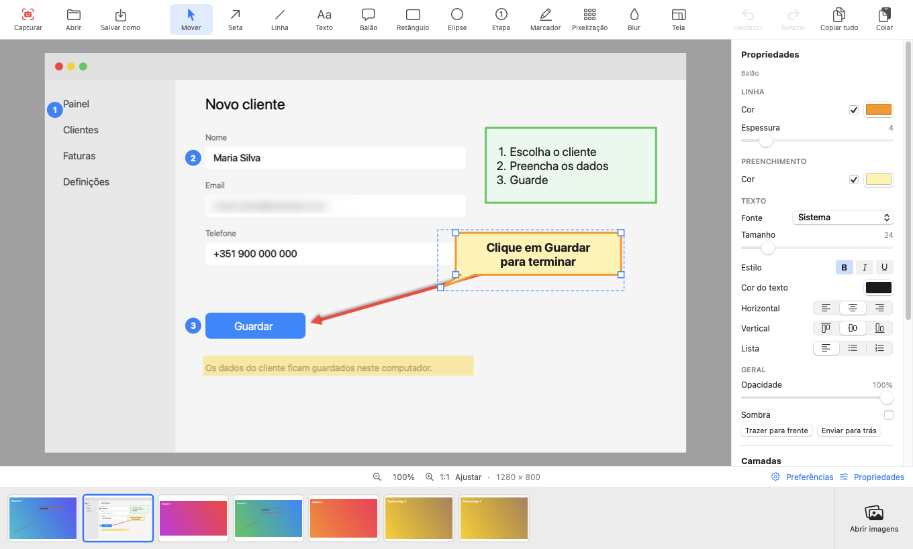
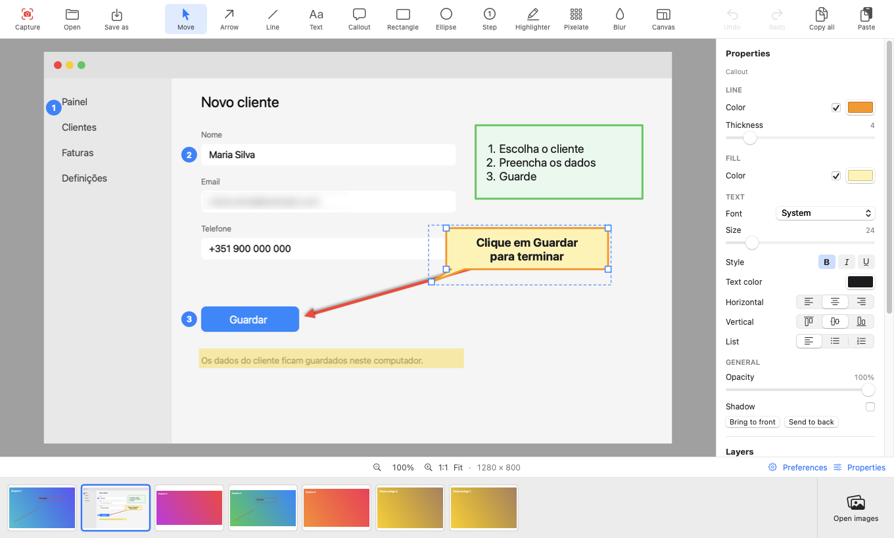

# Toth

**Captura e anota o ecrã no Mac. Tudo local: sem conta, sem nuvem, sem telemetria. Gratuita.**
*Capture and annotate your Mac screen. Fully local: no account, no cloud, no telemetry. Free.*

[Português](#português) · [English](#english)

> **Versão 1.0.0 (pré-visualização).** Descarregue em [**Releases**](../../releases/latest). A app ainda não está notarizada pela Apple (ver *Instalar*) e os documentos legais são rascunhos. Este repositório só tem a página de descarregamento; o código-fonte é privado.

---

## Português

### O que faz

**Captura**
- **Região com o ecrã congelado** ao carregar no atalho: a captura é a do momento do atalho, mesmo que o ecrã mude depois. Arraste para escolher a área, **mova-a e redimensione-a** pelas alças, e só ao **confirmar** (botão *Capturar* ou **Enter**) segue para o editor. **Esc** cancela. Funciona com vários monitores.
- **Ecrã inteiro** pelo menu da barra de menus.
- **Atalho global configurável** (por omissão **⌃⇧4**) em *Preferências*; avisa se a combinação é do sistema ou já está em uso.

**Editor (não destrutivo: a imagem original nunca é alterada)**
- **Ferramentas:** Mover, Seta, Linha, Texto, Balão, Retângulo, Elipse, Etapa, Marcador, Pixelização, Blur e Tela.
- **Texto no próprio objeto** (texto, balão, retângulo, elipse): fonte, tamanho, negrito/itálico/sublinhado, cor, alinhamento horizontal e vertical, listas de marcadores ou numeradas.
- **Cores da linha e do preenchimento** à escolha, espessura, opacidade e sombra.
- **Etapas numeradas** (1, 2, 3 · I, II, III · i, ii, iii · A, B, C · a, b, c), com cor do círculo e do número, fonte e **reinício da sequência**.
- **Blur e Pixelização** com intensidade ajustável, para ocultar informação sensível.
- **Área de trabalho (Tela):** aumente ou diminua a imagem, com cor de fundo ou transparente; **expande-se sozinha** quando um elemento sai da área.
- **Camadas:** ordem, ocultar, remover. Qualquer elemento pode ser removido ou editado **mais tarde**, mesmo depois de fechar e reabrir.
- **Copiar, colar, duplicar**; cola **imagens e texto de outras apps**. Desfazer/refazer, zoom e deslocamento.
- **Exportar PNG** ou **copiar tudo** para a área de transferência.

**Biblioteca**
- Grelha com a **pré-visualização atual** de cada captura, para escolher clicando; faixa de miniaturas no editor; importar imagens (PNG, JPEG, HEIC, TIFF, GIF, BMP).
- Cada captura é **um só ficheiro `.capture`** (um ZIP normal) em `~/Pictures/Capture`.

**Comodidades**
- Cada ferramenta **lembra a última personalização**, mesmo depois de fechar a app.
- **Português e inglês**, com mudança imediata em *Preferências*.
- **Privacidade:** a app não usa a internet nem recolhe dados.

### Requisitos
macOS 15 ou superior (Apple Silicon e Intel; testado em Apple Silicon).

### Instalar
1. Em [**Releases**](../../releases/latest), descarregue `Toth-1.0.0.zip` e descomprima.
2. Arraste `Toth.app` para a pasta **Aplicações**.
3. **Primeira abertura:** como a app ainda não está notarizada pela Apple, o macOS bloqueia-a. Clique com o botão direito em `Toth.app` → **Abrir** → **Abrir**. (Em alternativa: *Definições do Sistema → Privacidade e Segurança → Abrir mesmo assim*, ou no Terminal `xattr -dr com.apple.quarantine /Applications/Toth.app`.)
4. Conceda a permissão de **Gravação de Ecrã** (*Definições do Sistema → Privacidade e Segurança → Gravação de Ecrã e Áudio do Sistema*) e volte a abrir a app. O Toth fica na **barra de menus**, sem ícone no Dock.

### Usar
Carregue em **⌃⇧4** (ou use o ícone na barra de menus) → escolha a área → **Enter** → anote → **Salvar como** / **Copiar tudo**. As **Preferências** (engrenagem no rodapé, ou ⌘,) têm o atalho e o idioma.

### Ainda não tem
Captura de janela e de scroll, temporizador, cursor na captura, vídeo/áudio/GIF, apagar uma área da imagem, versão para Windows. Fora do âmbito por decisão: contas, partilha online, IA na nuvem e telemetria.

### Licença, privacidade e contacto
Gratuita, de código fechado. Dúvidas e problemas: abra uma *issue* neste repositório. © 2026 **Matéria Primordial, Unipessoal Lda** (NIF 515982890). [Licença](LICENSE.md) ([EN](LICENSE.en.md)) · [Privacidade](PRIVACY.md) · [Segurança](SECURITY.md) · [Avisos de terceiros](THIRD_PARTY_NOTICES.md).

---

## English

### What it does

**Capture**
- **Region capture with a frozen screen:** the screen freezes the moment you press the shortcut, so the capture is that exact moment even if the screen changes afterwards. Drag to choose the area, **move and resize** it with the handles, and only when you **confirm** (*Capture* button or **Enter**) does it go to the editor. **Esc** cancels. Multi-monitor aware.
- **Full-screen capture** from the menu bar.
- **Configurable global shortcut** (default **⌃⇧4**) in *Preferences*; it warns if a combination is taken by the system or already in use.

**Editor (non-destructive: the original image is never changed)**
- **Tools:** Move, Arrow, Line, Text, Callout, Rectangle, Ellipse, Step, Highlighter, Pixelate, Blur and Canvas.
- **Text directly in the object** (text, callout, rectangle, ellipse): font, size, bold/italic/underline, color, horizontal and vertical alignment, bulleted or numbered lists.
- Your choice of **line and fill colors**, thickness, opacity and shadow.
- **Numbered steps** (1, 2, 3 · I, II, III · i, ii, iii · A, B, C · a, b, c), with circle and number colors, font, and **sequence restart**.
- **Blur and Pixelate** with adjustable strength, to hide sensitive information.
- **Work area (Canvas):** enlarge or shrink the image, with a background color or transparent; it **expands automatically** when an element goes outside the area.
- **Layers:** order, hide, remove. Any element can be removed or edited **later**, even after closing and reopening.
- **Copy, paste, duplicate**; pastes **images and text from other apps**. Undo/redo, zoom and pan.
- **Export PNG** or **copy all** to the clipboard.

**Library**
- A grid with the **current preview** of each capture to pick by clicking; a thumbnail strip in the editor; import images (PNG, JPEG, HEIC, TIFF, GIF, BMP).
- Each capture is **a single `.capture` file** (a standard ZIP) in `~/Pictures/Capture`.

**Conveniences**
- Each tool **remembers its last customization**, even after you quit the app.
- **Portuguese and English**, switchable instantly in *Preferences*.
- **Privacy:** the app never uses the internet and collects no data.

### Requirements
macOS 15 or later (Apple Silicon and Intel; tested on Apple Silicon).

### Install
1. Under [**Releases**](../../releases/latest), download `Toth-1.0.0.zip` and unzip it.
2. Drag `Toth.app` to **Applications**.
3. **First launch:** the app is not yet notarized by Apple, so macOS blocks it. Right-click `Toth.app` → **Open** → **Open**. (Alternatively: *System Settings → Privacy & Security → Open Anyway*, or in Terminal `xattr -dr com.apple.quarantine /Applications/Toth.app`.)
4. Grant the **Screen Recording** permission (*System Settings → Privacy & Security → Screen & System Audio Recording*) and reopen the app. Toth lives in the **menu bar**, with no Dock icon.

### Use
Press **⌃⇧4** (or use the menu bar icon) → choose the area → **Enter** → annotate → **Save as** / **Copy all**. **Preferences** (gear icon in the footer, or ⌘,) hold the shortcut and the language.

### Not yet available
Window and scrolling capture, timer, cursor in captures, video/audio/GIF, erasing an area of the image, a Windows version. Out of scope by design: accounts, online sharing, cloud AI and telemetry.

### License, privacy and contact
Free, closed source. Questions and problems: open an issue in this repository. © 2026 **Matéria Primordial, Unipessoal Lda** (NIF 515982890). [License](LICENSE.en.md) · [Privacy](PRIVACY.md) · [Security](SECURITY.md) · [Third-party notices](THIRD_PARTY_NOTICES.md).
